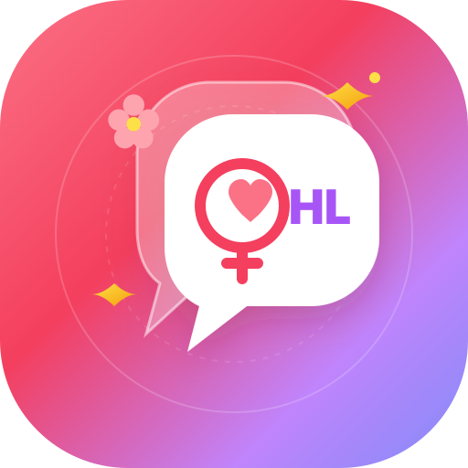

# HtetLingo

> **Learn Languages. Understand Words. Connect Cultures.**

<p align="center">
  
</p>

<p align="center">
  <b>Founded by Htet</b><br/>
  An ambitious, community-rooted multilingual learning, dictionary, translation, and AI tutoring platform for <b>English, Burmese (မြန်မာ), Japanese (日本語), Chinese (中文), Thai (ภาษาไทย), French (Français), German (Deutsch), Korean (한국어)</b>, and more.
</p>

<p align="center">
  <a href="https://htetlingo.pages.dev" target="_blank"><b>🚀 Launch Live Web App</b></a> •
  <a href="https://htetofficial.github.io/HtetLingo/" target="_blank"><b>🌐 Landing Page</b></a> •
  <a href="https://htetofficial.github.io/HtetLingo/docs.html" target="_blank"><b>📖 Documentation</b></a> •
  <a href="https://htetofficial.github.io/HtetLingo/demo.html" target="_blank"><b>🎮 Interactive Demo</b></a>
</p>

---

## 🌟 Vision & Platform Philosophy

**HtetLingo** is not merely a dictionary app. It is a comprehensive **Multilingual Learning, Dictionary, Translation, and AI Tutoring Platform**.

In a connected global world, learning a language is not just memorizing words—it is understanding thought patterns, nuances, and cultural contexts. HtetLingo bridges these worlds with deep native-language explanations (especially in Burmese and English) and cognitive acquisition methods.

---

## 🏗️ Architecture: Web-First, Offline-First, Cross-Platform

HtetLingo is built with a modern, portable architecture:

- **Web-First (Cloudflare Pages):** Instant access on any desktop or mobile browser with zero installation barrier and low-latency global edge delivery (`htetlingo.pages.dev`).
- **Offline-First (PWA & IndexedDB):** Designed specifically for learners in areas with intermittent connectivity. Lessons, vocabulary flashcards, grammar guides, and dictionary entries remain 100% accessible offline via client-side caching and Service Workers.
- **Cross-Platform Native (Android, iPad, Mac):** Standardized architecture adaptable with Capacitor into native Android (APK/AAB), iPadOS (Split-view multi-column), and macOS native applications.

---

## ✅ Core Features

- [x] **Vocabulary:** Spaced Repetition System (SRS) with active recall intervals (Again, Hard, Good, Easy), CEFR/JLPT/HSK levels, and native audio.
- [x] **Grammar:** In-depth, culturally nuanced grammar modules with sentence formulas and side-by-side explanations in Burmese and English.
- [x] **Quiz & Exercises:** Adaptive multiple-choice challenges, listening comprehension tests, and sentence rearrangers.
- [x] **Pronunciation & Listening:** Web Speech Synthesis API with native voice mapping, 0.75x slow mode, and speech recognition for pronunciation practice.
- [x] **Dictionary:** Instant multilingual lookup with phonetic transcriptions (IPA, Romaji, Pinyin), parts of speech, examples, and personal word bookmarks.
- [x] **Translation:** Bidirectional translation and essential situational phrasebooks (Travel, Food, Business, Emergency).
- [x] **Offline Learning:** Full offline capabilities using IndexedDB and Service Worker caching.
- [x] **Learning Progress:** Gamification engine with daily streaks, XP points, mastered word counters, and level progression badges.
- [x] **User Accounts:** Cloud database and authentication powered by Supabase with Row Level Security (RLS) and offline guest fallback.

---

## 💎 Business Model & Subscriptions

- **Free Tier:** Core vocabulary, basic dictionary search, and daily practice quizzes at no cost.
- **Premium Subscription ($7.99/mo):** Unlimited interactive HtetAI Tutoring conversations, in-depth grammar courses, speech pronunciation scoring, and ad-free experience.
- **Lifetime VIP ($79.99 one-time):** Permanent access to all present and future languages, with zero recurring fees.
- **Optional Specialty Learning Packs:** Standalone expansions such as *JLPT N5–N1 Mastery*, *HSK 1–6 Fluency*, and *Business English*.
- **Integrated In-App Purchases:** Powered by RevenueCat SDK.

---

## 🌐 Deployments & Websites

1. **GitHub Pages (`docs/` folder):**
   - **Landing Page:** [`index.html`](https://htetofficial.github.io/HtetLingo/)
   - **Documentation Website:** [`docs.html`](https://htetofficial.github.io/HtetLingo/docs.html)
   - **Interactive Static Demo:** [`demo.html`](https://htetofficial.github.io/HtetLingo/demo.html)
2. **Cloudflare Pages (`app/` folder):**
   - **Live Web App:** [`https://htetlingo.pages.dev`](https://htetlingo.pages.dev)
3. **Supabase Database (`supabase/` folder):**
   - **Schema & RLS Policies:** [`supabase/schema.sql`](supabase/schema.sql)

---

## 🗺️ Open-Source Language Datasets Roadmap

To expand the platform to hundreds of thousands of words, HtetLingo is architected to ingest and cross-reference leading open datasets:

1. **Tatoeba Project:** Millions of multilingual sentence pairs and translations.
2. **JMdict & Kanjidic (EDRDG):** Gold-standard Japanese dictionary and kanji databases.
3. **CC-CEDICT:** Open Mandarin Chinese lexicon with Pinyin and character variants.
4. **SEAlang Library & OpenBurmese:** Authentic Southeast Asian lexical databases and phonetics.
5. **Wiktionary:** Community-curated multilingual definitions and etymology.

---

## 🛠️ Local Development

```bash
# Clone the repository
git clone https://github.com/htetofficial/HtetLingo.git
cd HtetLingo

# Run the Web App locally
npx serve app

# Run the Documentation / Landing page locally
npx serve docs
```

---

## 📄 License & Credits

Created and maintained with love by **Htet (htetofficial)**.
Part of the open-source mission to connect languages and cultures worldwide.
